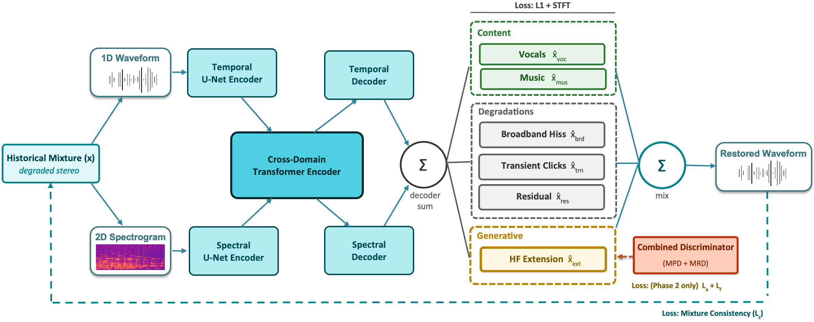

# RESTORE: REal-time Steerable Music resTORation and bandwidth Extension via stem disentanglement



Inference code for restoring degraded/historical (78rpm-era) recordings.
Separates a mixture into 6 stems -- `vocals`, `music`, `broadband` (noise),
`transient` (clicks/thumps), `residual`, `extension` (high-frequency content above the recording's bandwidth) -- then recombines
the clean content with the regenerated extension into a single restored
track.

- Paper: https://arxiv.org/abs/2609.28683
- Demo / audio samples: https://melissachen15.github.io/restore-audio-demo/

## Setup

```bash
pip install -r requirements.txt
```

Requires Python 3.9+ and a working PyTorch install (CUDA optional; CPU
inference works, just slower). `checkpoint.th` (168 MB) is bundled in this
repo via [Git LFS](https://git-lfs.com) -- install it once, then clone
normally:

```bash
git lfs install          # one-time, per machine
git clone <this repo>
```

If you already cloned without LFS set up, `checkpoint.th` will be a small
text pointer file instead of the real weights -- run `git lfs pull` inside
the repo to fetch it.

## Usage

```bash
python infer.py \
    --checkpoint checkpoint.th \
    --input examples/flamenco1_1min.wav \
    --output-dir out/
```

(`examples/flamenco1_1min.wav`: a 1-minute excerpt of a real, out-of-distribution
78rpm flamenco recording -- not synthetic, not seen in training -- included for
a quick end-to-end sanity check.)

Writes `out/{vocals,music,broadband,transient,residual,extension}.wav`
(the 6 raw stem estimates) plus `out/restored.wav` (the final restored
track -- content + extension, crossover-stitched; see note below). Pass
`--stems-only` to skip `restored.wav`. `--device cuda`/`cpu`, `--overlap`,
`--segment`, `--shifts` tune the chunked long-audio inference path
(`demucs.apply.apply_model`); defaults are sane for arbitrary-length clips.

## Layout

```
infer.py        CLI entry point
model.py        checkpoint loading (demucs.htdemucs.HTDemucs + trained weights)
stitch.py       content/extension crossover fix (see note below)
audio_io.py     WAV read/write/resample
checkpoint.th   trained weights
demucs/         vendored subset of Meta's demucs (MIT-licensed; see demucs/LICENSE) --
                only the inference-path modules needed by htdemucs.HTDemucs + apply_model
```

> **Note:** `restored.wav` is not a plain sum of all 6 stems -- the
> noise/residual stems are dropped, and the content/extension seam is
> crossover-filtered per clip (`stitch.py`) rather than summed at a fixed
> boundary, to avoid a spectral hole at the join.


## License

Code: CC BY-NC 4.0 (see `LICENSE`). The vendored `demucs/` subdirectory is
Meta Platforms' own MIT-licensed code (see `demucs/LICENSE`) and keeps its
original license.

## Acknowledgments

Built on [demucs](https://github.com/facebookresearch/demucs) (htdemucs,
Défossez et al., Meta AI) and informed by the
[BABE2](https://github.com/eloimoliner/BABE2) /
[denoising-historical-recordings](https://github.com/eloimoliner/denoising-historical-recordings)
line of work on historical-recording restoration.
